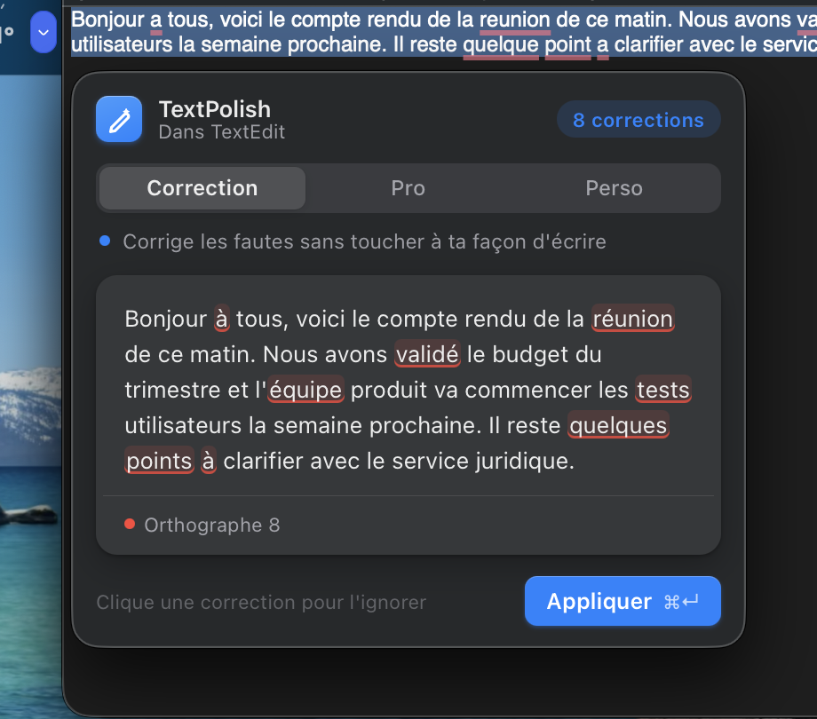

# TextPolish Cloud


**TextPolish Cloud** polishes your text using Google Gemini — free, fast, no local model needed.

Select text in any app, press **⌥⌘G**, review the fixes, and the text is pasted back. Runs silently in the menubar / system tray.

<p align="center">
  
</p>

The popup reads the selection, then adapts: one card per correction for short texts, a highlighted document for long ones (above), a single rewrite in Pro / Sur mesure.

> **Prefer a fully offline version?** → [TextPolish](https://github.com/Enguerrand-Roques/textpolish) uses a local Ollama model — no internet required.

---

## Features

| Feature | Description |
|---------|-------------|
| **Three modes** | Correction (fixes mistakes only, default), Pro (⌘2, professional rewrite), Sur mesure (⌘3, your own request: translate, shorten, warmer…) |
| **Review before pasting** | Accept or ignore each fix (↵ / ⇥), or everything at once (⌘↵) |
| **Every fix explained** | Each correction is labelled (spelling, accent, conjugation, agreement, homophone, punctuation); short texts get one card per fix, long ones a highlighted document |
| **Correction history** | Last 10 corrections in the ✏️ menu → Historique. Click an entry to copy |
| **Privacy** | Your text is sent to Google Gemini for each request and the app does not log it. On the free tier Google may use requests to improve its products — use [TextPolish](https://github.com/Enguerrand-Roques/textpolish) (local) for sensitive text |
| **System-level** | Works in any app — VS Code, Notion, Mail, Slack. Panel stays above fullscreen apps |
| **Free tier** | No credit card required. Google caps requests per minute and per day (10 per minute on `gemini-2.5-flash-lite` when tested in November 2026); current limits: [Gemini rate limits](https://ai.google.dev/gemini-api/docs/rate-limits) |

Shortcut: **Cmd+Option+G** (macOS) · **Ctrl+Alt+G** (Windows)

---

## Get a free API key

Before installing, grab a free Gemini API key — no credit card required:

1. Go to [aistudio.google.com](https://aistudio.google.com)
2. Sign in with a Google account
3. Click **Get API key** → **Create API key**
4. Copy it — you'll paste it into `config.py` during setup

The free tier has per-minute and daily limits ([current values](https://ai.google.dev/gemini-api/docs/rate-limits)); normal daily use stays well under them.

---

## Installation

<details>
<summary><strong>macOS</strong></summary>

### Requirements
- macOS 13+
- Python 3.13
- A free Gemini API key (see above)
- Accessibility permission (granted on first launch)

### Setup

```bash
git clone https://github.com/Enguerrand-Roques/textpolish-cloud.git
cd textpolish-cloud
bash setup.sh
```

`setup.sh` handles everything:
- Creates the Python virtual environment and installs dependencies
- Copies `config.example.py` → `config.py`
- Registers the Launch Agent (survives reboots)
- Creates **TextPolishCloud.app** on your Desktop

Then open `config.py` and paste your API key:

```python
GEMINI_API_KEY = "your-key-here"
```

### Start

Double-click **TextPolishCloud.app** on your Desktop.
A ✏️ icon appears in the menubar — the app is running.

### Shortcut

`Cmd + Shift + P`

### Permissions

On first launch, macOS will ask for:
- **Accessibility** — required for the global shortcut and simulated copy/paste
- **Input Monitoring** — may appear alongside Accessibility

Grant both in **System Settings → Privacy & Security**.

### Auto-start on login (optional)

In `~/Library/LaunchAgents/com.user.textpolish-cloud.plist`, set `RunAtLoad` to `<true/>`, then reload:

```bash
launchctl bootout gui/$(id -u) com.user.textpolish-cloud
launchctl bootstrap gui/$(id -u) ~/Library/LaunchAgents/com.user.textpolish-cloud.plist
```

### Troubleshooting

| Problem | Fix |
|---------|-----|
| `Invalid API key` | Double-check your key in `config.py` — no extra spaces |
| `Too many requests in one minute` / `quota exceeded` | Free-tier limit: wait a few seconds (per-minute) or until the daily reset |
| Shortcut not working | Grant Accessibility in System Settings |
| Text not pasted back | Keep the source app focused |
| App won't start | Check `/tmp/textpolish-cloud.log` for errors |

</details>

---

<details>
<summary><strong>Windows</strong></summary>

### Requirements
- Windows 10+
- Python 3.11+
- A free Gemini API key (see above)

### Setup

```bash
git clone https://github.com/Enguerrand-Roques/textpolish-cloud.git
cd textpolish-cloud
python -m venv venv
venv\Scripts\activate
pip install -r requirements-windows.txt
copy config.example.py config.py
```

Then open `config.py` and paste your API key:

```python
GEMINI_API_KEY = "your-key-here"
```

### Start

```bash
python main.py
```

A ✏️ icon appears in the system tray — the app is running.

### Shortcut

`Ctrl + Shift + P`

### Troubleshooting

| Problem | Fix |
|---------|-----|
| `Invalid API key` | Double-check your key in `config.py` — no extra spaces |
| `Too many requests in one minute` / `quota exceeded` | Free-tier limit: wait a few seconds (per-minute) or until the daily reset |
| Shortcut not working | Make sure no other app uses Ctrl+Shift+P |
| Text not pasted back | Keep the source app focused |

</details>

---

## Configuration

Edit `config.py` (excluded from Git — never committed):

```python
GEMINI_API_KEY = "your-key-here"
GEMINI_MODEL   = "gemini-2.5-flash-lite"   # recommended — fast and free
SHORTCUT       = "<cmd>+<alt>+g"           # auto-mapped to Ctrl on Windows
```

Available models (all on the free tier):

| Model | Speed | Quality |
|-------|-------|---------|
| `gemini-2.5-flash-lite` | Fastest | Good — recommended |
| `gemini-2.5-flash` | Fast | Better |
| `gemini-2.0-flash` | Fast | Good alternative |

---

## Modes

| Mode | Best for |
|------|----------|
| **Correction** (default) | SMS, DMs, notes — fixes mistakes, keeps your words and tone |
| **Pro** (⌘2) | Emails, reports, LinkedIn, formal writing |
| **Sur mesure** (⌘3) | Your own request: translate, shorten, warmer, funnier |

**Speed:** about 0.5 s per request, measured on `gemini-2.5-flash-lite`; the first request after launch is no slower, since there is no model to load. Depends on your connection. The free tier allows 10 requests per minute.

---

## Project Structure

```
textpolish-cloud/
├── main.py              # Entry point — detects OS, loads the right backend
├── clipboard.py         # Copy / paste logic  ─┐
├── llm.py               # Gemini request layer  ├─ shared across platforms
├── prompts/             # Prompt templates      ─┘
├── config.example.py
│
└── platforms/
    ├── macos/           # PyObjC · NSPanel · CGEventTap
    │   ├── ui.py
    │   ├── main.py
    │   └── hotkey.py
    └── windows/         # PyQt6 · QSystemTrayIcon · pynput
        ├── ui.py
        ├── main.py
        └── hotkey.py
```

---

## Background

This project started as a way to understand how to use a cloud AI API in a real personal tool — not just a demo, but something actually usable every day.

Building it surfaced a few things that tutorials don't really cover:

- **API latency in practice** — `gemini-2.5-flash-lite` answered a short sentence in about 0.5 s in our tests, the first request included. Fast enough to feel instant, but you still need a status indicator for slow networks.
- **Free tier limits are real constraints** — the daily cap sounds like a lot until you use the tool heavily, and the per-minute cap (10 on Flash-Lite) is easy to hit when testing. Choosing the right model (`flash-lite` vs `flash`) is a real product decision, not just a performance one.
- **The API is the easy part** — calling Gemini takes 10 lines of code. The complexity was everywhere else: global shortcuts, clipboard handling, making a window appear above fullscreen apps, pasting into the right window without disrupting focus.
- **Cloud vs. local** — no setup friction for the user (no Ollama, no model download), but you're dependent on internet and a third-party service. The right choice depends on who your users are.

Beyond the technical side, this project was also an exercise in building something the way a real open source project is built — using Conventional Commits (`feat:`, `fix:`, `chore:`...), maintaining a proper `LICENSE`, writing a README that someone else can actually follow, and structuring code so it makes sense to a stranger reading it on GitHub. Small habits that make a big difference when a project grows or gets contributors.

The companion project [TextPolish](https://github.com/Enguerrand-Roques/textpolish) explores the same use case but with a fully local Ollama model — no internet, no API key, at the cost of more setup.

---

## Related

- [TextPolish](https://github.com/Enguerrand-Roques/textpolish) — same tool, runs fully offline with a local Ollama model
